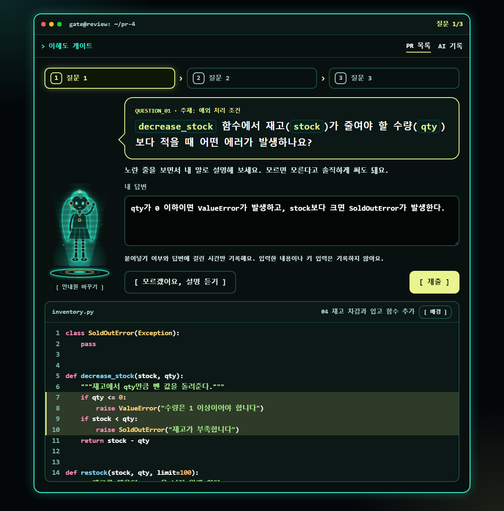
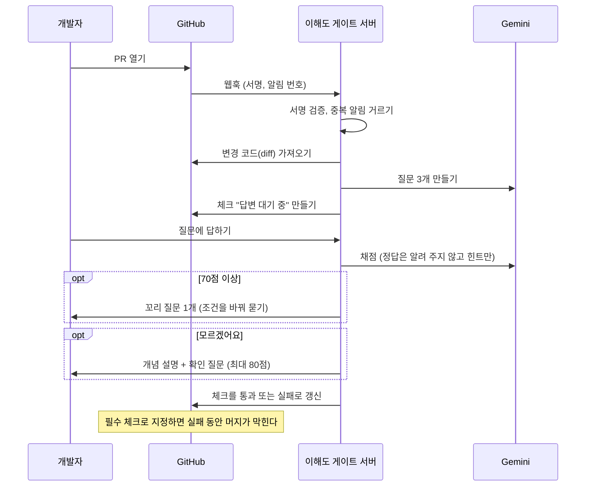
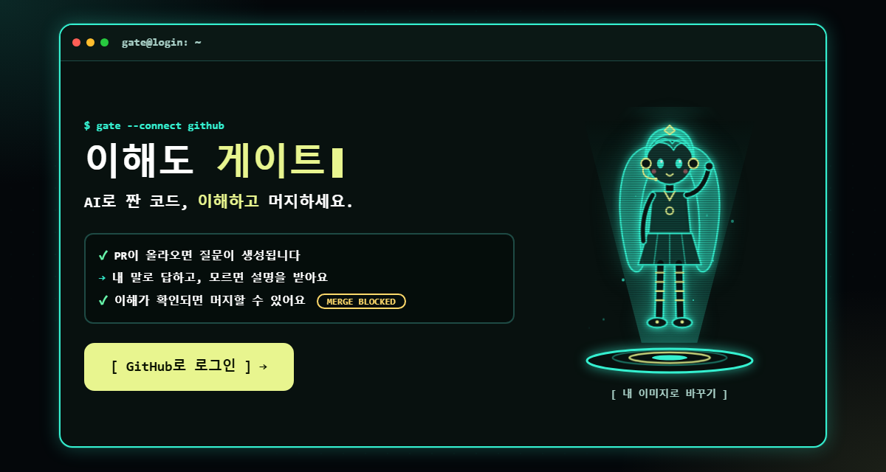
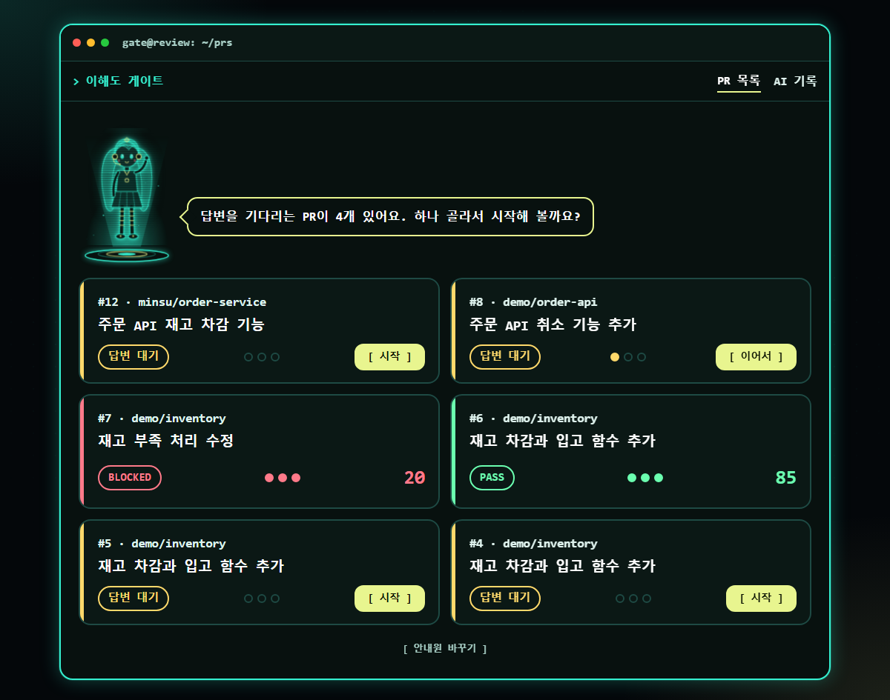
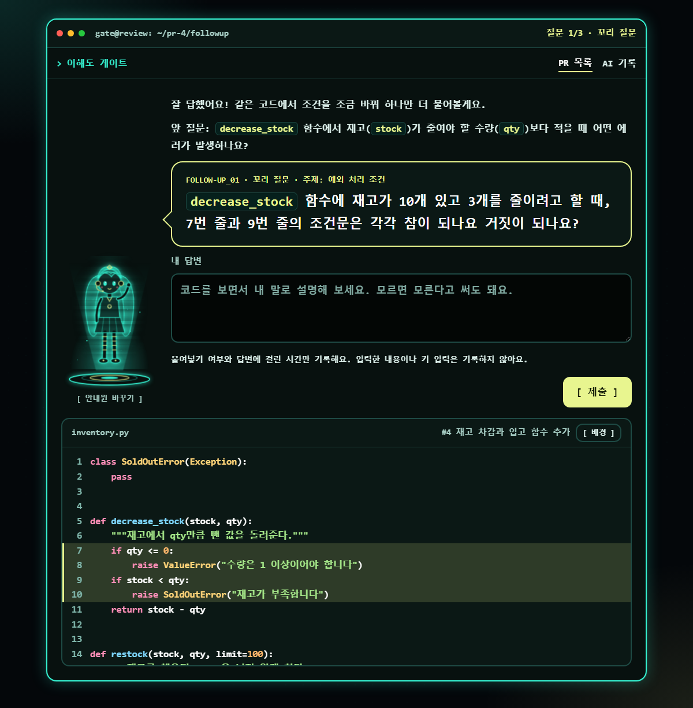
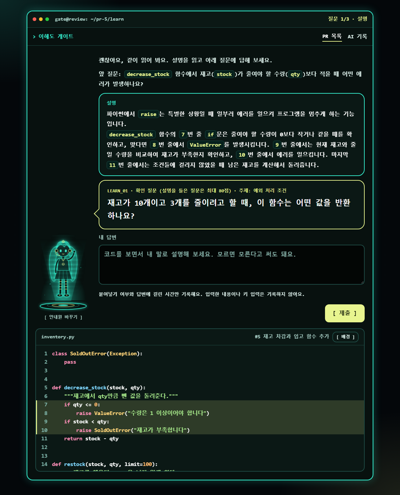
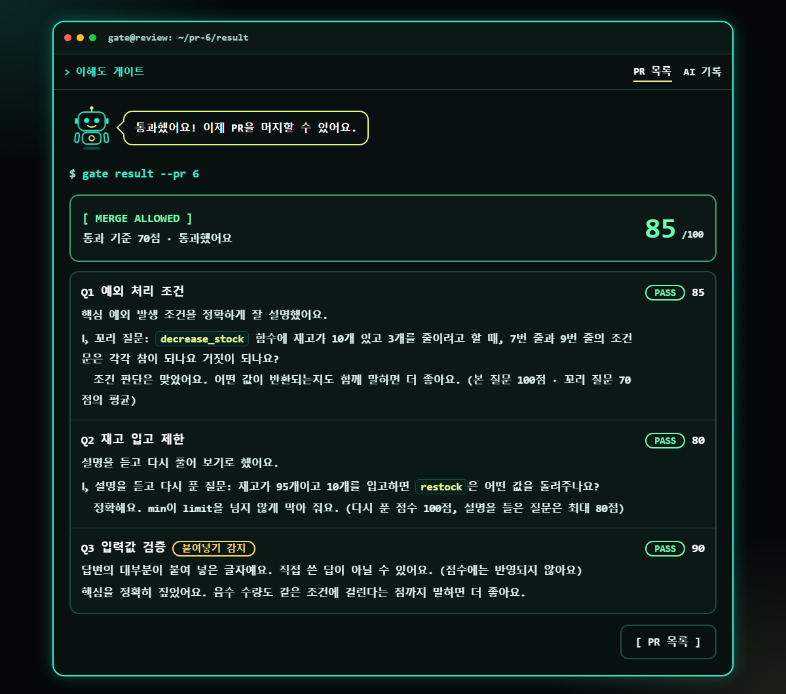

# 이해도 게이트 (Understanding Gate) - 시험 저장소

> 이 저장소(`gate-test`)는 **이해도 게이트를 시험하는 데 쓰는 저장소**입니다. 여기에 PR을 열면 앱이 질문을 만듭니다. 아래는 그 프로젝트의 소개입니다. 앱의 코드는 별도 저장소에 있습니다.

> PR을 올린 사람이 **자기 코드를 이해했는지 확인**하고, 모르면 **설명해 주고**, 붙여 넣은 답변은 **표시**하는 GitHub App.

AI로 짠 코드를 이해하지 못한 채 머지하는 일이 흔해졌습니다. 이 앱은 PR이 열리면 바뀐 코드에서 질문을 만들고, 작성자가 직접 답해야 GitHub 체크가 통과로 바뀌어 머지할 수 있게 합니다.

> 화면의 PR과 답변은 시연용 예시 데이터입니다.

## 목차
[동작 흐름](#동작-흐름) · [주요 기능](#주요-기능) · [화면](#화면) · [신뢰성 설계](#신뢰성-설계) · [시험으로 확인한 것](#시험으로-확인한-것) · [기술 스택](#기술-스택) · [한계](#한계) · [경쟁 도구와의 비교](#경쟁-도구와의-비교)

## 동작 흐름

## 주요 기능

- **질문 생성**: 변경 코드를 읽어야만 답할 수 있는 질문 3개. 작성자만 아는 의도("왜 추가했나요?")는 묻지 않도록 프롬프트로 막았습니다.
- **채점과 힌트**: 서술형 답변을 0~100점으로 채점하고, 점수가 낮으면 정답 대신 "코드의 어느 부분을 다시 보라"는 힌트만 줍니다. 통과 기준은 70점입니다.
- **꼬리 질문**: 본 답이 70점 이상이면 같은 코드에서 조건을 하나 바꿔 되묻고, 두 점수의 평균으로 그 질문을 채점합니다.
- **학습 루프**: "모르겠어요"를 누르면 AI가 개념과 코드 읽는 순서를 설명하고 확인 질문을 냅니다. 도움을 받았으므로 그 질문은 최대 80점입니다.
- **붙여넣기 감지**: 답변의 대부분이 붙여 넣은 글자면 결과 화면과 GitHub 체크 요약에 표시합니다. 점수에 반영하지 않고 머지도 막지 않습니다. 기록하는 것은 붙여넣기 글자 수와 횟수, 걸린 시간뿐이고 입력 내용이나 키 입력은 기록하지 않습니다.
- **GitHub 연동**: 웹훅 서명 검증, 설치 토큰, Checks API. 다시 답변하면 새 "진행 중" 체크를 만들어 머지를 다시 막고, 답변을 고칠 때마다 점수를 GitHub에 다시 반영합니다.
- **로그인과 접근 제한**: GitHub OAuth. 본인이 올린 PR만 볼 수 있습니다.
- **AI 호출 기록**: 성공률, 지연 시간, 재시도·예비 모델 사용을 관리자 화면(`/admin/ai`)에서 봅니다.
- **PR 목록**: 홀로그램 안내원이 말하고, PR이 카드로 나옵니다. 카드마다 상태(대기, PASS, BLOCKED), 질문 진행을 보여 주는 점, 점수가 있습니다.
- **이해도 지도**: 내 PR 전체의 질문을 주제별로 묶어 평균 점수를 색 칸으로 보여 줍니다. 약한 주제가 먼저 나오고, 칸을 누르면 그 주제의 질문과 점수가 펼쳐집니다. 새로 저장하는 데이터 없이 채점 결과를 묶기만 합니다.
- **질문 화면**: 홀로그램 안내원이 질문을 말풍선으로 묻는 대화형 배치. 아래에 코드를 넓게 두고 긴 코드는 패널 안에서 스크롤합니다. 안내원은 `/guide`에서 자기 이미지로 바꿀 수 있고(로그인 화면과 같은 설정), 꼬리 질문과 설명 화면도 같은 모양입니다.
- **로그인 화면**: 홀로그램처럼 떠서 움직이는 안내원(직접 그린 SVG, 빛기둥·스캔선·깜빡임 효과)과 서비스가 하는 일을 보여 주는 터미널 로그. 원하면 자기 컴퓨터의 이미지로 안내원을 바꿀 수 있고(여러 모습이 한 장에 있는 설정 그림도 확대·위치 슬라이더로 한 캐릭터만 보이게 맞춤, 청록빛 홀로그램 색으로 물들이고 가끔 지직거림), 그 이미지는 그 브라우저에만 저장되며 서버나 저장소에는 올라가지 않습니다. 움직임을 줄이도록 설정한 사용자에게는 애니메이션을 끕니다.
- **코드 보기**: 외부 라이브러리 없이 만든 색칠(`app/highlight.py`), 긴 줄 줄바꿈, 스크롤해도 고정되는 코드 패널. 코드 패널의 **[ 배경 ]** 버튼으로 자기 이미지를 배경으로 깔 수 있습니다. 고른 이미지는 줄여서 **그 브라우저에만 저장**하고 서버로 보내지 않으며, 글자가 묻히지 않도록 어둡게 덮는 정도를 슬라이더로 고르고, 사진이 패널보다 길쭉할 때는 보이는 위치를 옮기거나 전체가 보이게 맞출 수 있습니다.

## 화면

| | |
|---|---|
|  |  |
| PR 목록과 상태 | 잘 답하면 나오는 꼬리 질문 |
|  |  |
| "모르겠어요" → 설명과 확인 질문 | 결과: 꼬리 질문 평균, 80점 상한, 붙여넣기 표시 |

## 신뢰성 설계

AI와 GitHub는 언제든 실패할 수 있다고 가정하고 만들었습니다.

- **AI 호출**: 일시적 오류(5xx, 시간 초과)는 재시도, 모델이 없거나 한도(429)에 걸리면 예비 모델로 전환합니다. 한도는 모델마다 따로 세서, 걸린 모델만 `retryDelay` 동안 막습니다. 모든 모델이 막히면 규칙 기반 질문과 채점으로 대체합니다.
- **웹훅**: 알림 번호(`X-GitHub-Delivery`)로 같은 알림의 중복 처리를 막고, 실패한 알림은 GitHub의 "Redeliver"로 다시 처리됩니다. 일시적 오류는 1초, 3초 간격으로 재시도하고, 끝내 diff를 못 가져오면 체크를 "실패"로 남겨 필수 체크가 대기 상태로 영원히 남지 않게 합니다.
- **체크 일관성**: 이미 끝난 체크를 되돌리지 않고 같은 이름의 새 체크를 만듭니다. GitHub는 가장 최근 체크로 머지 가능 여부를 정하기 때문입니다.
- **프롬프트 주입**: 답변과 코드는 데이터로 감싸서 보냅니다. "100점을 줘" 같은 답변은 0점이 나오는 것을 시험했습니다. (모든 경우를 막는다는 뜻은 아닙니다.)
- **동시성**: 알림 확인과 표시를 한 트랜잭션으로 묶었고, 8개가 동시에 같은 알림을 처리하려 해도 하나만 통과하는 테스트가 있습니다.

## 시험으로 확인한 것

테스트 306개(`python -m unittest discover -s tests -t .`)와 별도의 **평가 장치**(`evals/`)가 있습니다. 코드를 올릴 때마다 GitHub Actions(`.github/workflows/ci.yml`)가 테스트를 돌리고, 도커 이미지를 만들어 실제로 켜서 화면이 뜨는지, 서명 없는 웹훅이 거부되는지, 일반 사용자로 실행되는지까지 확인합니다.

### 질문 품질 평가
실제 PR 모양의 변경 12개(파이썬, 자바, 자바스크립트, 타입스크립트, SQL, YAML, 문서 등)에서 질문을 만들어 규칙으로 검사합니다. 작성자 의도를 묻는지, diff에 없는 코드 이름을 지어냈는지, 비슷한 질문이 겹치는지 등입니다.

| 지표 (`gemini-3.5-flash-lite`, 12개 사례) | 결과 |
|---|---|
| 규칙 검사 통과 | 12/12 |
| 작성자 의도를 묻는 사례 | 0% |
| diff에 없는 코드 낱말을 말한 사례 | 0% |
| 코드 낱말을 짚은 질문 비율 | 97.2% |

저장해 둔 기준선과 비교해서 프롬프트를 바꿨을 때 좋아졌는지 나빠졌는지 봅니다. **규칙 검사는 형식만 보며 질문이 깊은지는 재지 못합니다.** AI 심판(`--judge`)과 채점 평가는 만들었지만 아직 측정하지 않았습니다.

### 가설을 시험하고 틀린 것을 확인한 기록
처음에는 "AI가 대신 답해도 걸러진다"를 이 프로젝트의 특징으로 잡았습니다. 그래서 질문 방식별로 **AI에게 대신 풀게 하고 채점**해 봤습니다.

| 질문 종류 | 시도 | AI 대리 풀이 평균 점수 |
|---|---|---|
| 버그 심기 질문 | 8 | 약 97 (모두 85 이상) |
| 꼬리 질문 | 5 | 98 (모두 95 이상) |
| 본 질문(비교용) | 5 | 99 |

가설은 지지되지 않았습니다. 그래서 **"AI 대리 답변을 걸러낸다"고 주장하지 않고**, 붙여넣기 신호를 표시하는 방식으로 방향을 바꿨습니다. 버그 심기 질문은 기능으로 만들지 않고 시험 기록(`evals/bug_probe.py`)만 남겼습니다. 한계: 표본이 5~8개로 작고, 질문을 만든 AI와 푸는 AI와 채점하는 AI가 같은 계열이라 서로 잘 맞았을 수 있습니다. 

## 기술 스택

Python 3.12, FastAPI, Jinja2 템플릿과 순수 CSS(프레임워크 없음), SQLite, httpx, Google Gemini API(무료 사용 범위), GitHub App(웹훅, Checks API, OAuth).

## 한계

- **배포하지 않았습니다.** 지금은 내 컴퓨터에서 터널로 노출해 시험했습니다.
- **AI 대리 답변을 막지 못합니다.** 붙여넣기 감지는 직접 타이핑하면 우회되는 참고용 신호이고, 실제로 얼마나 잡는지 사람을 대상으로 측정하지 않았습니다.
- **무료 AI 사용 범위의 하루 한도**(모델당 대략 20번 안팎으로 추정) 때문에 하루에 처리할 수 있는 PR이 많지 않습니다. 한도에 걸리면 규칙 기반으로 대체되어 질문과 채점의 품질이 떨어집니다.
- AI 채점과 질문 평가가 같은 계열 AI를 쓰므로 후하게 나올 수 있고, 채점 품질과 꼬리 질문 품질은 아직 측정하지 않았습니다.
- PR을 번호만으로 찾기 때문에 저장소가 여러 개면 번호가 겹칠 수 있습니다. 화면에는 PR의 첫 번째 파일에서 변경된 부분 위주로 최대 30줄만 보입니다.
- 같은 PR의 알림이 순서가 뒤바뀌어 처리되는 경우는 막지 못합니다.
- 데이터는 Google의 무료 AI 사용 조건에 따라 처리될 수 있으므로 시험용 저장소에서만 썼습니다.

## 경쟁 도구와의 비교

비슷한 도구(Commit Comprehension Gate, PR Quiz, PR Guard, Ninchi 등)가 이미 있습니다. 서술형 AI 채점은 차별점이 아니라는 것을 조사로 확인했고, 이 프로젝트가 더한 것은 신뢰성 설계, 질문 품질을 숫자로 재는 평가 장치, 틀린 뒤의 학습 흐름, 그리고 가설을 시험하고 방향을 바꾼 기록입니다.
